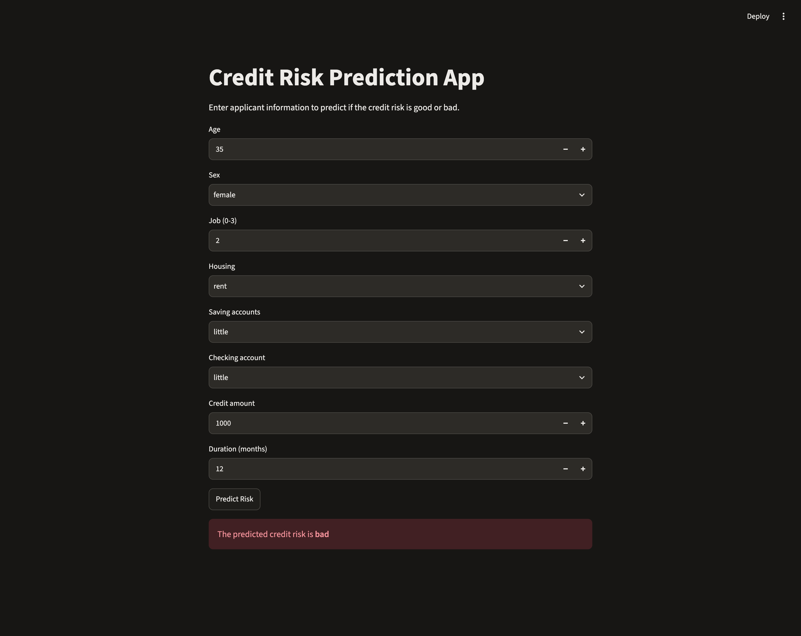

# 💳 Credit Risk Prediction

Modèle de machine learning qui prédit si une demande de crédit présente un risque **faible** (`good`) ou **élevé** (`bad`), avec une application web Streamlit pour tester des profils en direct.



## 📌 Contexte

Une banque doit décider rapidement si elle accorde un crédit. Ce projet couvre tout le parcours d'un projet data : analyse des données, préparation, comparaison de modèles et mise à disposition via une interface simple.

## 📊 Données

[German Credit Risk (with target)](https://www.kaggle.com/datasets/kabure/german-credit-data-with-risk) — Kaggle
1 000 demandes de crédit, 10 variables : âge, sexe, emploi, logement, comptes épargne / courant, montant, durée, objet du crédit et la cible `Risk`.

## 🛠️ Démarche

1. **Nettoyage** — suppression des lignes sans info sur les comptes (522 lignes restantes).
2. **Analyse exploratoire** — distributions, outliers, corrélations, lien de chaque variable avec le risque.
3. **Feature engineering** — sélection de 8 variables, encodage des variables texte (`LabelEncoder`).
4. **Modélisation** — Decision Tree, Random Forest et Extra Trees, optimisés avec `GridSearchCV` (validation croisée 5 plis) et `class_weight="balanced"` pour gérer le déséquilibre des classes.
5. **Déploiement** — export du modèle et des encodeurs avec `joblib`, application Streamlit.

## 📈 Résultats

| Modèle | Accuracy (test) |
|---|---|
| Decision Tree | 0.58 |
| Random Forest | **0.67** |
| Extra Trees | **0.67** |

**Enseignements clés :** les crédits à risque ont en moyenne un montant plus élevé et une durée plus longue ; un compte courant bien fourni réduit nettement le risque.

## 🚀 Lancer le projet

```bash
# 1. Cloner le repo
git clone https://github.com/<ton-pseudo>/credit-risk-model.git
cd credit-risk-model

# 2. Installer les dépendances
pip install -r requirements.txt

# 3. Télécharger le dataset sur Kaggle et le placer dans data/german_credit_data.csv

# 4. Exécuter le notebook (crée le modèle dans models/)
#    credit_risk_analysis.ipynb -> Run All

# 5. Lancer l'application
streamlit run app.py
```

## 📁 Structure

```
credit-risk-model/
├── data/                        # dataset (à télécharger, non versionné)
├── models/                      # modèle + encodeurs générés par le notebook
├── images/                      # captures pour le README
├── credit_risk_analysis.ipynb   # analyse, feature engineering, modélisation
├── app.py                       # application Streamlit
├── requirements.txt
└── README.md
```

## 🔭 Pistes d'amélioration

- Garder les lignes incomplètes avec une catégorie « inconnu » au lieu de les supprimer
- Ajouter la variable `Purpose` et tester XGBoost
- Évaluer avec le recall et le F1-score (rater un client à risque coûte plus cher qu'un faux refus)
- Déployer l'app sur Streamlit Community Cloud

## 🧰 Outils

Python · pandas · NumPy · Matplotlib · Seaborn · scikit-learn · joblib · Streamlit
